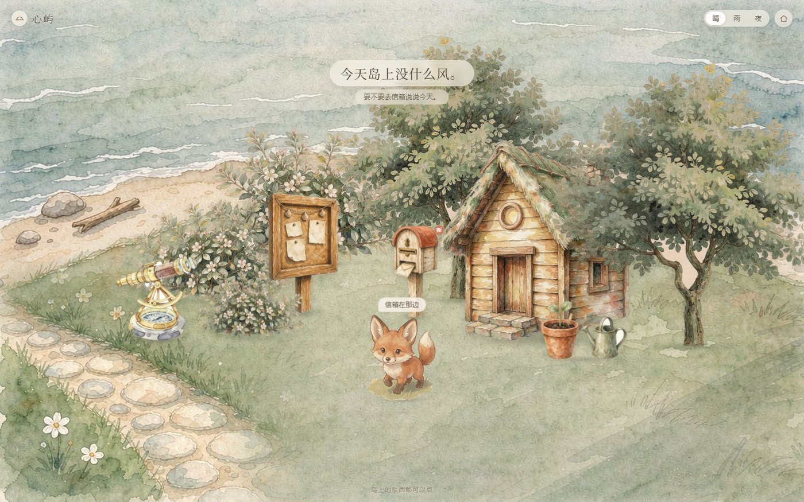
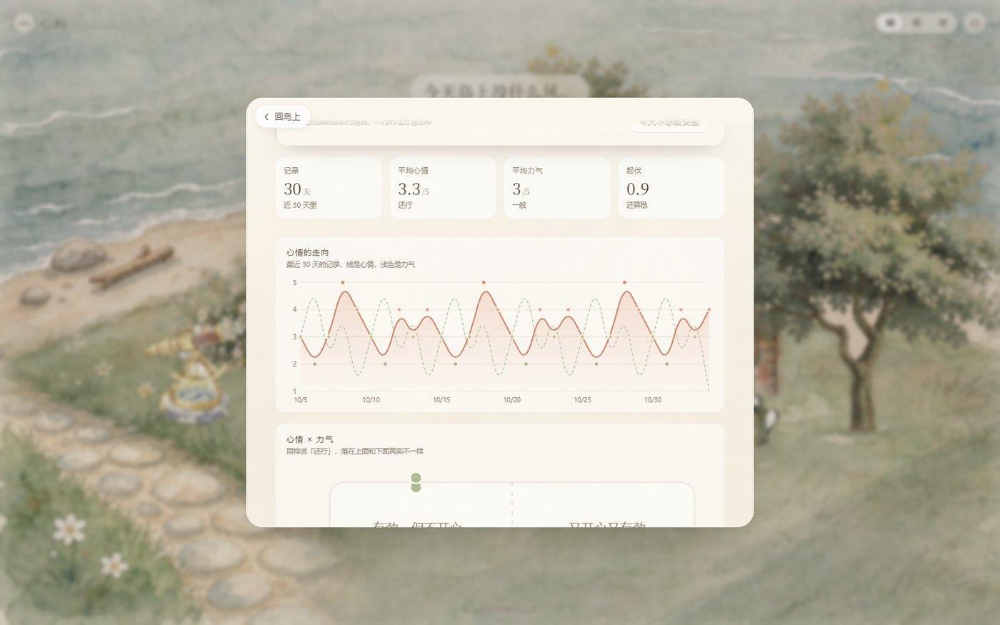
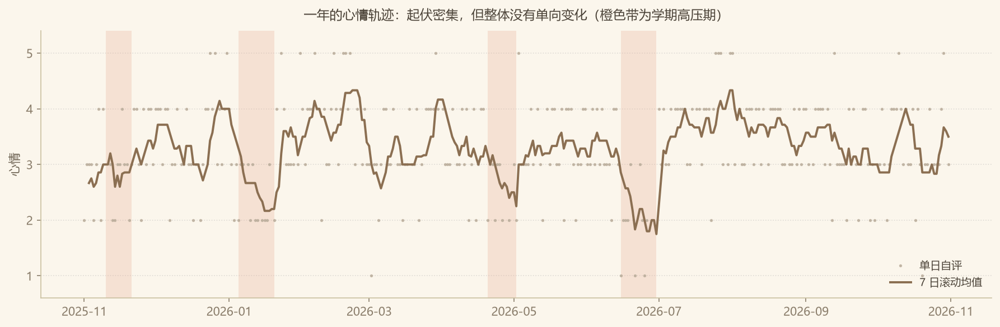

# 心屿 · 一座可以说话的小岛

每天往信箱里投一次心情，岛上会慢慢长出东西。

> 一个纯静态的情绪记录网站。没有框架、没有构建步骤、没有第三方依赖，双击 `index.html` 就能跑。



---

## 它在做什么

打开是一张水彩小岛。岛上有五个东西可以点，各自通向一个页面：写今天的心情、看花园里长出的植物、看趋势、看日历、调设置。

记录只需要两个数——**心情（1–5）** 和 **力气（1–5）**，加几个标签、一句想说的话。就这么多。没有连续打卡天数、没有成就徽章、没有排行榜。

记下来之后会发生三件事：花园里长出一株对应心情颜色的植物、观测台累积出曲线、日历上多一个色点。

## 五个可以点的地方

| 位置 | 是什么 | 对应 |
|---|---|---|
| 信箱 | 记录今天 | 打卡页 |
| 望远镜 | 观测台 | 趋势分析 |
| 公告板 | 日历 | 月历 + 色点 |
| 盆栽 | 花园 | 情绪植物 |
| 小木屋 | 设置 | 导出 CSV / 声音 / 岛上会动 |

## 几个不显然的产品决定

这些比界面本身更花时间，而且都是「不做某件事」的决定：

1. **断签不提示。** 连续记录的压力会让人在断掉那天彻底放弃。所以日历上不显示「已连续 N 天」，断了也没有任何提示或补签入口。
2. **不是打分表，是画图。** 观测台的副标题写的就是这句。所有指标只描述「发生了什么」，不评价「好不好」。
3. **一次只给一张建议卡。** 分析出多个问题时按严重度挑一张，不堆叠。卡片固定四段：看到 / 也许 / 试试 / 我在，总长不超过 120 字，且每张都带一个「今天不想被安慰」的退出口。
4. **文案禁用词写成了测试断言。** 「抑郁」「焦虑症」「诊断」「病情」「风险等级」不许出现在任何页面，`test/smoke.test.js` 里有一条断言专门扫页面全文——只要有人改文案时手滑写了，测试就红。

## 技术选择

| 选择 | 原因 |
|---|---|
| 无框架、无构建 | 目标用户不该为了记一笔心情去装 Node |
| 不用 ES module | `file://` 下会因 CORS 直接失败。要保住「双击就能开」，就只能用普通 `<script>` + 全局命名空间 |
| 坐标全走 CSS 变量 | 竖屏要另一套落点，写行内样式会被媒体查询压不过 |
| 手写 SVG 图表 | 三张图，为它们引一个 100KB 的图表库不划算，也画不出纸感 |
| WebAudio 现场合成音效 | 四个音效。素材已经 67MB，为几声轻响再塞 wav 不值 |
| localStorage + 异步接口 | 数据层（`store.js`）所有接口都返回 Promise，将来换 Supabase 只改这一个文件 |

## 三个真问题是怎么解的

**1. 设计稿和用户窗口的比例永远对不上**

素材是按 1536×960（1.6）排的，但没人有正好的窗口。背景用 `cover` 会让物件按视口高度算的百分比错位——网页和设计预览看起来就是两个样子。

解法是造一个固定比例的**舞台**：`.island` 用 `min(100vw, 100vh*1.6)` × `min(100vh, 100vw/1.6)`，背景 `100% 100%` 拉满舞台，所有物件的百分比都相对它。窗口不是 1.6 时，舞台居中，两侧（或上下）用同一张图放大 1.08 + 模糊 46px 垫底。

代价是非 1.6 的窗口有虚化补边（2:1 窗口各约 10%）。接受它——比错位好。

**2. 走动的角色怎么自动被树挡住**

狐狸每帧把自己的 `z-index` 设成**脚底的 y 坐标**，背景里每个物件的 `z-index` 也等于它脚底的 y。于是「走到树后面就被遮住」自动成立，不需要任何遮挡检测。代价是所有素材的 `--y` 必须精确到脚底那一像素。

**3. 「回岛上」按钮曾经彻底点不动**

`closeSheet()` 里有个 `closing` 标志防重入，靠 230ms 的 `setTimeout` 复位。只要那个回调里有一句抛错，标志就永远停在 `true`，之后每次点击都进不了函数体——按钮死掉，只能刷新。

现在的写法：定时器句柄存起来，`openSheet()` / `closeSheet()` 都先 `clearTimeout` 并复位；`fox.resume()` 包一层 `safeResume()`；地址栏操作排在关卡之后，且 `pushState` 失败时退用 `location.hash=''`（`file://` 和沙箱 iframe 里 `pushState` 会抛 `SecurityError`）。

## 观测台的分析引擎

全部是阈值规则，不是模型——这个体量的数据也不需要模型。

指标：均值、振幅、标准差、线性回归斜率（每天变化量）、连续低落天数、14 天低落占比、精力-情绪背离（力气 ≤2 而心情 ≥4）、星期分布、月度聚合。

| 级别 | 条件 | 行为 |
|---|---|---|
| L0 | 记录不足 4 天 | 不出卡，提示再记几天 |
| L1 | 平稳 | 默认不出卡 |
| L2 | 标准差 ≥1.05 或振幅 ≥3 或斜率 ≤−0.09/天 或背离 ≥3 天 | 出一张轻的卡 |
| L3 | 连续低落 ≥5 天，或 14 天里 ≥60% 是低分 | 一张关怀卡 |
| L4 | 有风险表达 + 连续低落 ≥8 天 | **不分析不劝导**，只给关怀和热线（12356） |



## 另做的一份数据分析

除了产品内置的分析引擎，还拿同一份数据做了一次独立的 N-of-1 纵向分析（pandas + scipy + matplotlib），验证「指标定义 → 分级规则 → 结论边界」这套流程。

数据是合成的，生成机制与真值参数全部写死在 `tools/gen-synthetic.py` 里（固定 seed，可复现），报告开头就声明了这一点。八节：数据质量 / 描述统计 / 时间趋势 / 星期效应 / 双维关系 / 低落期特征 / 漏记偏差（MNAR）/ 参数回收验证。



值得单独提的两个结论：一是**心情与力气虽有强相关（r = 0.69），但存在 1.31 分的稳定落差**——情绪会起伏，体力是结构性偏低，这是两件事；二是**缺失不是随机的**，漏掉的那 34 天平均低 0.69 分，导致观测均值系统性高估约 2%。

完整报告见 [`analysis/报告.md`](analysis/报告.md)。

## 目录

```
index.html              唯一页面：岛屿 + 纸卡容器 + 仪式层（hash 路由）
styles/main.css         全部样式：色板、物件坐标表、纸卡、图表卡、响应式
scripts/
  store.js              数据层（localStorage，接口异步）
  analysis.js           分析引擎：指标、分级、建议卡文案库
  plant.js              花园的 SVG 植物（心情定颜色花形，力气定高度叶数）
  fox.js                岛民状态机：wander / idle / sit / sleep + 眨眼 + 呼吸 + 摸头
  views.js              五个页面的渲染与事件
  sound.js              四个音效，WebAudio 现场合成
  app.js                路由 / 天气 / 问候 / 提交仪式 / 设置应用
test/
  logic.test.js         分析引擎与存储层（40 项，纯 node）
  smoke.test.js         真实 DOM 冒烟（65 项，jsdom，走完整交互链）
tools/prep-sprite.py    素材后处理：去水印 → 抠纸底 → 补内洞 → 裁边
tools/add-path.py       把石子路贴回背景（三种天气，含调色）
tools/gen-synthetic.py  合成数据生成器（显式生成机制 + 固定 seed）

data/                   合成数据集 + 真值参数
analysis/
  analyze.py            八节 N-of-1 分析
  figures/              五张图
  报告.md               完整分析报告
```

约 3,600 行前端代码 + 1,050 行 Python 工具。

## 跑起来

```bash
# 方式一：直接双击 index.html（就是为了这个才不用 ES module）

# 方式二：起个静态服务，推荐
python -m http.server 8899
# 打开 http://localhost:8899/
```

## 测试

```bash
node test/logic.test.js          # 40 项，不需要浏览器

python -m http.server 8778       # 另开一个终端
NODE_PATH=./node_modules node test/smoke.test.js   # 65 项，需要 jsdom
```

冒烟测试要连本地服务是因为它用 jsdom 从 `http://` 加载真实页面，走一遍点物件 → 填表 → 提交 → 看分析 → 导出的完整链路。端口可用 `XINYU_PORT` 覆盖。

当前 **105 项全过**。

## 数据在哪

全部在浏览器 `localStorage` 的 `xinyu.v1` 下，不上传任何服务器。换设备靠小木屋里的**导出 CSV**（带 UTF-8 BOM，Excel 直接打开不乱码），备注里的逗号、换行、引号都做了转义。导入同时认 CSV 和旧版 JSON，认列名不认列位置。

清一下浏览器数据就没了——这是刻意的，但也是现在最大的限制。

## 素材

所有水彩素材由 AI 图像生成（文生图 / 图生图），**生成之后全部在本地做了后期**：去右下角水印、按纸底泛洪抠图、闭运算补内洞（狐狸尾巴尖是奶白色，和纸底同色，泛洪会顺着铅笔线的缺口灌进去把尾巴整块吃掉）、开运算清碎块、裁边，最后输出 WebP。

风格统一靠「以图定风」：拿一张已定稿的素材当参考图，只迁移画风不迁移主体。早期按扁平厚描边风格生成的一批角色，和水彩物件摆在一起明显是两个世界，整批重做过。

## 已知限制

- **没有后端。** 数据只在当前浏览器，换设备要手动导出导入
- **竖屏没适配。** 媒体查询还在，但用的是旧构图的值，认真做得整套重排
- **窗口比例不是 1.6 时有虚化补边**（见上面「舞台」那节）
- **年视图的折线按周平均**，最多 52 个点；如果某几个月完全没记，空档会被压缩，曲线看起来还是连着的
- `tune.html` 是调坐标用的工具页，预览画布比正式站窄 302px，在上面定的稿搬到全宽会略空

## 还没做

- 接后端 + 登录（`store.js` 的接口已经全异步，表结构也留了 `user_id`）
- 手机竖屏重排
- 年报长页：365 格色带 + 一句总结
- 换岛民：水豚和小鸭的素材已经有了

---

素材：AI 生成 + 本地 Pillow 后处理。代码：手写，无脚手架。
