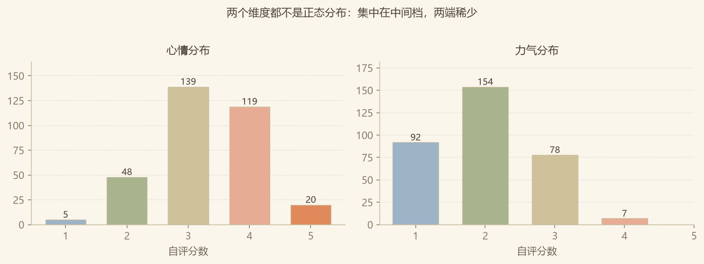
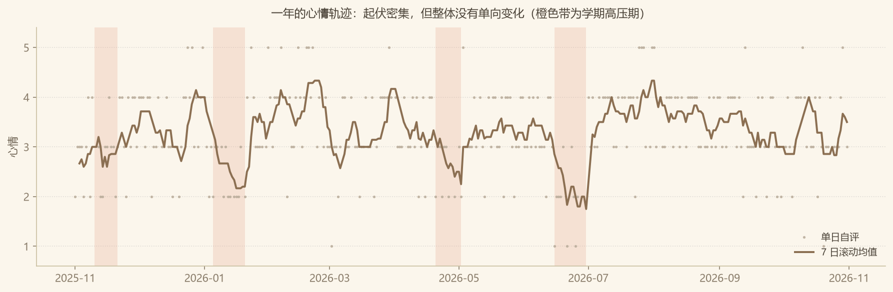
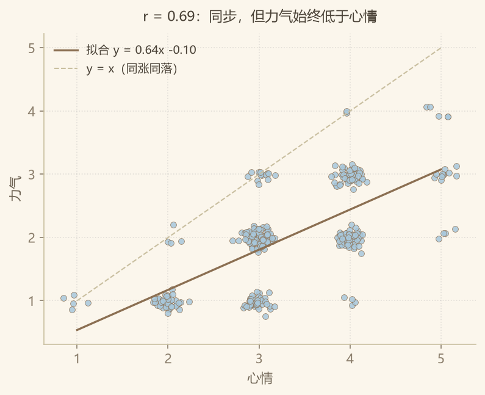
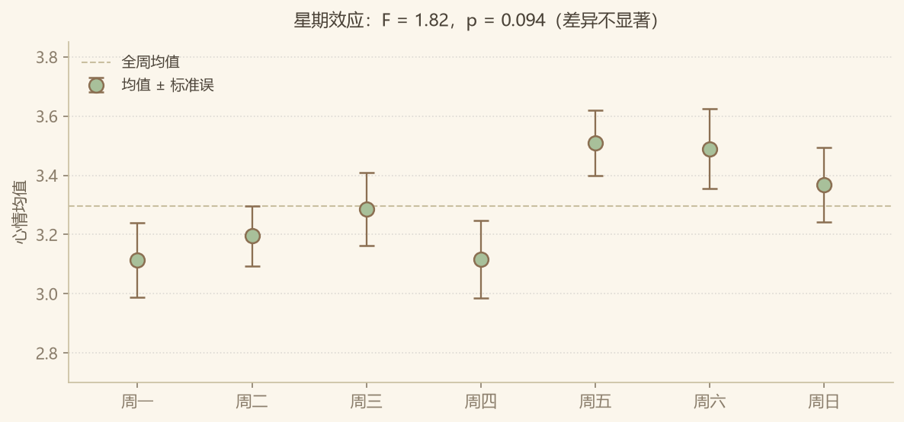
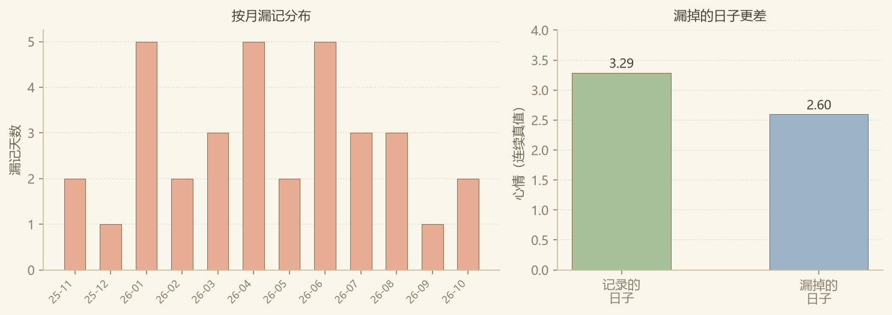

# 心屿 · 一年情绪记录的数据分析

> **数据声明**：本文使用**合成数据**（365 天，其中 331 天有记录），由 `tools/gen-synthetic.py` 按显式设定的生成机制产出，**不来自任何真实个体**。
> 用途是在没有长期真实记录的前提下，验证「指标定义 → 分级规则 → 结论边界」这套分析流程是否成立。
> 生成参数与真值保存在 `data/ground_truth.json`，第 8 节用它们做了参数回收验证。
> 若换成真实记录（同一份 CSV 格式），全部分析流程无需改动。

---

## 一、数据与口径

| 项目 | 说明 |
|---|---|
| 区间 | 2025-11-01 – 2026-10-31，共 365 天 |
| 有效记录 | 331 天，缺失 34 天（9.3%），无重复、无越界取值 |
| 核心字段 | `心情`、`力气`，均为 1–5 整数自评 |
| 辅助字段 | `睡眠时长`（小时）、`是否运动`（0/1）、`标签`、`备注` |
| 分析粒度 | 日级。产品自带的月度聚合不做分析单位——一年只有 12 个点，撑不起任何检验 |

口径上有一处必须先定死：**所有「平均心情」都是「有记录的那些天的平均」，不是「这一年的平均」**。第 7 节会证明这两者不等。

---

## 二、两个维度长什么样



| | 均值 | 标准差 | 中位数 | 范围 |
|---|---|---|---|---|
| 心情 | 3.31 | 0.85 | 3 | 1–5 |
| 力气 | 2.00 | 0.77 | 2 | 1–4 |
| 睡眠 | 6.2 h | 0.77 | — | — |

三个值得注意的地方：

1. **两个维度都不是正态分布**，而是集中在中间档：心情有 78% 落在 3–4 分，力气有 75% 落在 1–2 分。这符合自评量表的一般规律（人倾向于避开极端档），但它直接影响后面所有统计——均值和标准差都不该被当作充分概括。
2. **力气一次都没有到过 5 分**，全年最高 4 分且只有 7 天（2%）。这不是评分习惯问题，是这个人全年没有「精力充沛」这种状态。
3. **两个均值差 1.31 分**。这是整份数据里最大的信号，见第四节。

---

## 三、一年里有没有变好或变差



线性回归：斜率 **+0.0005 分/天**（折合 +0.18 分/年），**p = 0.254**。

结论：**这一年没有整体性的恶化或改善**。起伏密集，但没有单向趋势。

这件事值得单独说，因为「记录了一年」很容易让人产生「我是不是越来越差了」的错觉。数据不支持这个判断——单日的大幅波动会让人记住低谷，而 7 日滚动均值（图里深色线）显示波动范围其实稳定在 1.75–4.33 之间，全年波动幅度 0.50 分。

7 日滚动的最低点是 **1.75（6 月 30 日）**，紧接期末周之后；最高点 **4.33（2 月 22 日）**，寒假末尾。这两个极值都不是随机的，说明**学期节奏是比「星期几」更强的结构**。

---

## 四、核心发现：心情会起伏，力气是常数



- Pearson **r = 0.694**，95% CI [0.633, 0.746]，p < 0.001，n = 331
- R² = 0.481，心情能解释力气约 48% 的方差
- 拟合线为 `y = 0.64x − 0.10`，**始终位于 y = x 之下**
- **20.2% 的日子（67 天）满足「心情 ≥ 4 而力气 ≤ 2」**——心情还行，人已经没电

这是我认为最值得说的一条。两个维度高度相关（同涨同落），但**存在一个稳定的、不随心情变化的落差**（平均 1.31 分）。

换句话说：心情是波动的，力气是**结构性偏低**的。心情好的日子里，力气也只是从 1 涨到 3，不会到 5。

如果只报「两个维度强正相关」，会得出完全错误的行动建议——「心情好了力气自然会好」。实际上更接近：**情绪恢复不能解决体力问题，这是两件事。**

对产品设计的直接启示：建议卡不该对两个维度用同一套话术。「今天心情不错」和「但你力气只有 1」应当被分别表述，而不是合并成一句「状态还行」。

---

## 五、星期几真的有影响吗（一个「不显著」的示范）



| 周一 | 周二 | 周三 | 周四 | 周五 | 周六 | 周日 |
|---|---|---|---|---|---|---|
| 3.11 | 3.20 | 3.29 | 3.12 | 3.51 | 3.49 | 3.37 |

单因素方差分析：**F = 1.82，p = 0.094**。

看图会觉得「周五周六明显更高」，误差棒也不与周一重叠。但统计上**没有达到显著**（p > 0.05），而且更关键的是：

- 周五与周一相差 0.40 分，**是单日自评标准差（0.85）的一半**
- 7 组两两比较共 21 次，不做多重比较校正就直接挑「周五最高」是在钓鱼
- 组间差异只解释了总方差的 3.3%（η²）

**结论：不足以据此安排任何事。** 报告「周五心情更好」在统计上站不住，在实践上也没有意义——0.4 分的差距小于日常波动。

> 这一节刻意保留了不显著的结果。数据分析里最容易被追问的不是「你发现了什么」，而是「这个差异显著吗、效应量多大、你做了多少次比较」。把不显著如实写出来，比硬找故事可信得多。

---

## 六、低落期 vs 平稳期

把「连续 ≥2 天心情 ≤2」切成低落段，共 17 天（占 5.1%）。

| | 心情 | 力气 | 睡眠 | 运动率 |
|---|---|---|---|---|
| 低落段（17 天） | 1.88 | 1.12 | **5.6 h** | **6%** |
| 平稳段（314 天） | 3.38 | 2.05 | **6.3 h** | **29%** |

- 睡眠时长差异：Welch t = −3.66，**p = 0.002**，低落段少睡约 0.7 小时
- 运动比例差异：χ² = 3.29，p = 0.069，方向一致但未达显著（低落段只有 1 天有运动）

**睡眠是这两组之间唯一显著的差异变量**，运动则是明显的趋势。

但这里必须踩一脚刹车：**这是相关性，不是因果，而且方向未定**。可能是睡少了所以心情差，也可能是心情差所以睡不着，也可能两者都由第三个因素（比如学业压力）驱动。数据本身无法分辨。

能说的只有一句：**睡眠是当前最值得优先干预的单一变量**，因为它效应最大、最好测量、也最容易改。这也正是产品该在记录里加「睡眠时长」字段的理由。

---

## 七、看不见的那 34 天（MNAR）



9.3% 的缺失不是随机的。用真值核对：

| | 天数 | 真值心情均值 |
|---|---|---|
| 有记录的日子 | 331 | 3.291 |
| 漏掉的日子 | 34 | **2.597** |

Mann-Whitney U 检验（单侧）：**p < 0.0001**。

漏掉的日子平均低 0.69 分。这不是巧合——**状态越差越不想打开那个 app**。

偏差量化：

- 观测到的均值：**3.291**
- 真实均值（含漏记日）：**3.227**
- **高估 +0.065 分（+2.0%）**

### 这个 2% 意味着什么

2% 在绝对量上很小，但真正有价值的是三件事：

1. **方向是确定的，不是随机的。** 如果是随机缺失，偏差会随样本增大而消失；这里不会。任何基于这份数据的平均水平，都**系统性地偏向好的一侧**。
2. **偏差随漏记率放大，且是非线性的。** 当前漏记率 9.3% 还好。如果状态变差导致漏记率升到 30%，偏差会扩大到 5% 以上——**而恰恰是在状态最差的时候，数据最不可信**。
3. **这会污染所有下游指标。** 连续低落天数会被漏记打断（真实连续 5 天可能只有 3 天有记录，永远触发不了 L3 分级）；14 天低落占比会被稀释。分级规则在数据缺失时是**系统性低估**的。

**唯一正确的处理是把这一节写进报告，而不是想办法「补」数据。** 插值或回填会制造虚假的精确感。

---

## 八、参数回收：我怎么知道自己的估计没跑偏

因为数据是合成的，我手上有真值。这提供了一个罕见的验证机会——**先假装不知道生成参数，只用数据反推，再回头比对**。

| 参数 | 估计值（仅用数据） | 设定值（真值） | 偏差 |
|---|---|---|---|
| 心情基线 | 3.305 | 3.500 | −0.195 |
| 力气基线 | 2.000 | 2.150 | −0.150 |
| 双维相关 | 0.694 | 0.720 | −0.026 |

三个估计都偏低，方向一致。原因可以解释：

- **基线偏低**是 MNAR 的直接后果（第七节）：漏掉的日子本来就更差
- **相关系数偏低**是取整与截断的后果：1–5 的整数评分压缩了连续真值的方差，衰减了相关系数（统计学上叫**离散化衰减**）

也就是说：**估计值的偏差本身是可预测的**。如果这是真实数据，我大概会说「真实基线应略高于观测值，幅度取决于漏记率」——这是一个可以被检验的猜想，而不是凭感觉的修正。

---

## 九、局限

1. **数据是合成的**，结论描述的是一个被设定出来的机制，不是真实的人
2. **n = 1**，一切结论仅对这一个体成立，不能外推到任何人群
3. **自评、单次、无对照**，同一分数在不同日子的含义可能不同（量表漂移）
4. **固定 1–5 整数**导致离散化衰减，压低相关系数，也让「1 分」和「2 分」之间的距离被强行等距化
5. **记录行为本身会改变状态**（观察者效应），这不是误差，是这类数据的固有属性
6. **不构成任何诊断或建议**，产品本身也刻意避开了诊断性表述

---

## 十、如果这是真实数据，接下来做什么

按性价比排序：

1. **在记录里加睡眠字段**（已验证与低落状态关联最强，p = 0.002）。三个字段的改动，换来一个真正可分析的变量
2. **改分级规则，处理缺失**：连续低落天数不应要求「连续有记录」，而应基于日历日期判断，否则会系统性低估
3. **对两个维度分别建模**：心情更适合时间序列（有周期、有事件响应），力气更像一个缓慢变化的基线，两者的预测方式不该相同
4. **补一份「为什么没记」的轻量入口**：一次点击即可记录「今天不想记」，把 MNAR 从不可观测变成可观测

第 4 条是最反直觉的一条：**与其想办法提高记录率，不如承认有些日子就是不会记，然后把这个事实本身记录下来。**

---

## 复现

```bash
python tools/gen-synthetic.py    # 生成数据（固定 seed，结果可复现）
python analysis/analyze.py       # 全部分析与图表
```

依赖：`pandas`、`numpy`、`scipy`、`matplotlib`。
图表输出到 `analysis/figures/`。
